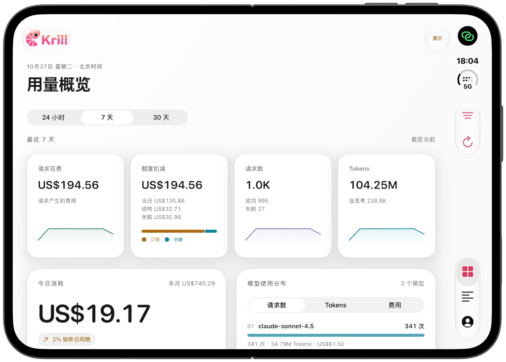
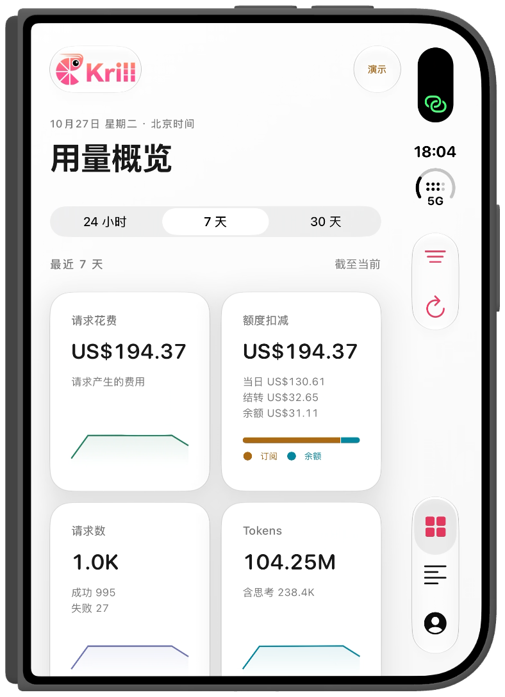

<p align="center">
  
</p>

<h1 align="center">Krill for iOS</h1>

<p align="center">每一次 API 调用，都看得更清楚。</p>
<p align="center"><strong>SwiftUI · Liquid Glass · iOS 26+ · SF Symbols</strong></p>

连接 [Krill](https://www.krill-code.com)，在 iPhone 上查看请求、费用、Token 与模型用量。为 iPhone Duo 的外屏和展开内屏设计，支持白色与黑夜两种外观。

## 看见你的用量

以下截图来自 **iPhone Duo 真机的游客模式演示数据**，不包含真实账户信息。

### 展开后，一屏掌握全局



请求花费、额度扣减、请求数、Tokens 四项摘要配合趋势图；今日消耗、小时热力图、模型分布与套餐用量在双栏中展开。

### 合拢后，随手查看

<p align="center">
  
</p>

同一组统计自动切换为适合窄屏的布局，保留当前页面与筛选。两张截图均保留设备边框，只裁去了设备外的多余背景。

白色与黑夜两种主题默认跟随系统，也可以在 App 中切换。界面使用苹果 SF Symbols 和系统 Liquid Glass。

## 核心体验

- **费用与用量总览**：滚动 24 小时、7 天、30 天统计，今日卡片单独展示当天消耗及较昨日同期变化。
- **7 × 24 小时热力图**：查看近期请求活跃时段，轻触方格读取请求数和费用。
- **模型使用分布**：按请求数、Tokens 或费用排序，展开查看全部模型。
- **额度与扣费来源**：区分当日额度、结转额度和余额扣费，查看各套餐使用进度。
- **请求明细**：支持模型、API Key、状态、扣费来源与协议筛选，分页加载更多记录。
- **原生自适应布局**：普通 iPhone 与 Duo 外屏采用单栏；宽屏采用双栏。登录页同样随可用宽度调整，折叠切换保留输入。
- **轻量登录**：支持邮箱密码、邮箱验证码和必要的 TOTP 验证。无需账号也可进入“游客模式查看”。

App 聚焦统计与只读数据查看，保留登录、退出和外观设置，不提供密码修改、安全设置或其他账户管理操作。

## 在你的 iPhone 上运行

需要 **Xcode 27.2 或更新版本**，设备运行 **iOS 26.0 或更新版本**。项目使用 Apple 系统框架，无第三方依赖。

```sh
git clone https://github.com/AliYa-chen/KrillAPP.git
cd KrillAPP
open Krill.xcodeproj
```

1. 选择 **Krill** Scheme。
2. 在 **Signing & Capabilities** 中选择自己的开发团队，必要时修改 Bundle Identifier。
3. 选择已配对、已开启开发者模式的真实设备，点击 **Run**。
4. 使用 Krill 账号登录，或点击 **游客模式查看**。

工程保留了本次调试使用的签名团队配置，其他开发者运行前应更换为自己的团队。详细步骤见 [真机运行指南](Docs/SETUP.md)。

游客模式使用本地演示数据，不会登录真实账户或上传这些数据。在 Scheme 的 Launch Arguments 中添加 `--demo`，可直接进入游客模式。

## 数据与接口

默认服务地址为 `https://www.krill-code.com`。登录令牌保存在系统钥匙串，工程不包含账号密码、测试令牌或 Cookie。

| 数据 | 接口 |
| --- | --- |
| 统计与趋势 | `POST /api/request-logs/stats` |
| 模型使用分布 | `POST /api/request-logs/model-stats` |
| 订阅额度 | `POST /api/subscription/quota-usage` |
| 扣费来源 | `POST /api/request-logs/quota-summary` |
| 请求记录 | `POST /api/request-logs` |

所有时间按北京时间展示。请求花费与额度扣减分别来自对应统计，不把缺失的补充数据当作零用量。字段映射、认证接口和计算口径见 [API 说明](Docs/API.md)。

## 开发与验证

只编译 iOS 真机产物：

```sh
xcodebuild -project Krill.xcodeproj -scheme Krill \
  -configuration Debug -destination 'generic/platform=iOS' \
  -derivedDataPath build CODE_SIGNING_ALLOWED=NO build
```

运行核心数据测试，无需启动模拟器：

```sh
swift test
```

测试覆盖时间范围、时区转换、缓存率、响应解析、状态筛选和统计聚合。未签名构建产物不能直接安装到真机；具体已完成与待验证项目见 [验证记录](Docs/VALIDATION.md)。

| 目录 | 内容 |
| --- | --- |
| `Krill/Features` | 登录、统计、请求详情与自适应页面 |
| `Krill/Design` | 主题、Liquid Glass 与视觉组件 |
| `Krill/Models` | 数据模型、解析和游客数据 |
| `Krill/Services` | 接口、会话及钥匙串 |
| `KrillTests` | 核心逻辑测试 |
| `Docs` | 接口说明、运行指南与截图 |
